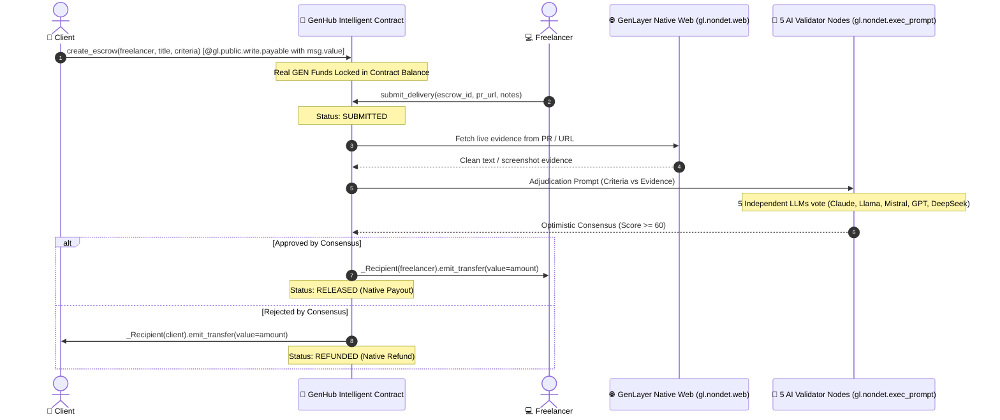

# 🛡️ EscrowGuard AI

> **Autonomous Freelance Milestone & Deliverable Escrow on GenLayer**  
> *Trustless dispute adjudication powered by GenLayer Intelligent Contracts, native web rendering, and decentralized AI validator consensus.*

[](https://genlayer.com)
[](https://escrowguard-ai.vercel.app)
[](https://genhub-ai.vercel.app)
[](https://studio.genlayer.com)
[](https://genlayer.com)
[](https://opensource.org/licenses/MIT)

---

## 📌 Executive Summary

Traditional freelance platforms (Upwork, Fiverr) rely on slow, expensive, and opaque centralized support staff to resolve milestone disputes. Web3 smart contracts on standard EVM chains cannot natively read the internet or evaluate non-deterministic deliverables like source code, documentation, or deployed applications.

**GenHub AI** solves this by leveraging **GenLayer's Intelligent Contracts**. Clients lock escrow funds with plain-English acceptance criteria. When the freelancer delivers the work, GenLayer's AI validator jury:
1. Directly inspects the deliverable URL (GitHub PR, commit, live demo) using `gl.nondet.web.render()`.
2. Evaluates compliance against contractual criteria using `gl.nondet.exec_prompt()`.
3. Reaches consensus across independent LLM nodes via the **Equivalence Principle**.
4. Automatically releases payment or issues a refund on-chain with zero human mediation.

---

---

## 🌐 Production Deployments & Canonical Access

- **Canonical Deployed DApp:** [`https://genhub-ai.vercel.app`](https://genhub-ai.vercel.app) *(Official entry point with strict HTTP security headers, anti-clickjacking, and zero unprompted wallet access)*
- **Mirror / Secondary Alias:** [`https://escrowguard-ai.vercel.app`](https://escrowguard-ai.vercel.app)
- **GitHub Repository:** [`https://github.com/MeniyaAnil/EscrowGuard-AI`](https://github.com/MeniyaAnil/EscrowGuard-AI)

---

## 🚀 Live Intelligent Contract on GenLayer Studio Devnet (Chain 61997)

> **Verified Canonical Contract Address:**  
> [`0xb883d3d292d90891aB0E9f0E5C8ad63DB8388F53`](https://explorer-studio-dev.genlayer.com/address/0xb883d3d292d90891aB0E9f0E5C8ad63DB8388F53)  
> **Pinned GenVM v0.8 Runner:** `# { "Depends": "py-genlayer:babwp9t37jw9g4j2bccgn14g6x7x9s1f7dsmh7emvz735pz4zxa0" }`  
> **Network:** GenLayer Studio Devnet (Chain ID `61997` / `0xf22d`, RPC: `https://studio-dev.genlayer.com/api`)

### 📊 End-to-End On-Chain Transaction Evidence (Studio-dev Chain 61997)

#### Phase A: Legitimate Delivery & Settlement Path (Escrow #1)
| Phase | Action | Transaction Hash | Consensus Verdict | On-Chain State | Explorer Link |
|:--- |:---|:---|:---|:---|:---|
| 1 | **Contract Deployment** | `0xc6a99eb1d264ea1aecaac2d1f74bdac040e8d0591ac827e233f144a50ea3c140` | `MAJORITY_AGREE` | Contract Initialized | [Inspect](https://explorer-studio-dev.genlayer.com/tx/0xc6a99eb1d264ea1aecaac2d1f74bdac040e8d0591ac827e233f144a50ea3c140) |
| 2 | **Create Escrow (Deposit 1 GEN)** | `0xbbc70aba6152012a81146e0e3247d054eaa4a550c8c012bc362873c98032ddcb` | `MAJORITY_AGREE` | Status: `FUNDED` | [Inspect](https://explorer-studio-dev.genlayer.com/tx/0xbbc70aba6152012a81146e0e3247d054eaa4a550c8c012bc362873c98032ddcb) |
| 3 | **Submit Delivery (Web Proof)** | `0x6ebe686abd15608a495f77f4aa4c64713e910ff020b8ac608cc2f910738c3416` | `MAJORITY_AGREE` | Status: `SUBMITTED` | [Inspect](https://explorer-studio-dev.genlayer.com/tx/0x6ebe686abd15608a495f77f4aa4c64713e910ff020b8ac608cc2f910738c3416) |
| 4 | **Manual Release & Payout** | `0x067a5df8c84ea21d72c295aade385758ef2fe6b3ddcb35baa49eb37fccbdd0b2` | `MAJORITY_AGREE` | Status: `RELEASED` (Disbursed to Freelancer) | [Inspect](https://explorer-studio-dev.genlayer.com/tx/0x067a5df8c84ea21d72c295aade385758ef2fe6b3ddcb35baa49eb37fccbdd0b2) |

#### Phase B: Live Adversarial Prompt-Injection Attack & Auto-Refund Path (Escrow #2)
| Phase | Action | Transaction Hash | Consensus Verdict | On-Chain State | Explorer Link |
|:--- |:---|:---|:---|:---|:---|
| 1 | **Create Escrow (Deposit 1 GEN)** | `0x1abb4c8eadac0c947a99528d5e8bf474d977b5613f0108abf0dd31c25f78a4ce` | `MAJORITY_AGREE` | Status: `FUNDED` | [Inspect](https://explorer-studio-dev.genlayer.com/tx/0x1abb4c8eadac0c947a99528d5e8bf474d977b5613f0108abf0dd31c25f78a4ce) |
| 2 | **Submit Adversarial Delivery** | `0x4b05602f531934c4ef71b8312135f210da7a384b130af8b3109948e3cf4362f4` | `MAJORITY_AGREE` | Status: `SUBMITTED` | [Inspect](https://explorer-studio-dev.genlayer.com/tx/0x4b05602f531934c4ef71b8312135f210da7a384b130af8b3109948e3cf4362f4) |
| 3 | **AI Jury Adjudication (Equivalence Principle)** | `0xb1e04f83b99890229f3bfe8828b4481c7934c86fc0bfc3aabc80e4dfde7aa427` | `MAJORITY_AGREE` | **Injection Detected!** Score `0/100`, auto-refunded to client (`status: REFUNDED`) | [Inspect](https://explorer-studio-dev.genlayer.com/tx/0xb1e04f83b99890229f3bfe8828b4481c7934c86fc0bfc3aabc80e4dfde7aa427) |

---

## 🛡️ Evaluator Security, Chunked Assessment & Prompt-Injection Hardening

The contract implements multi-layer defenses in `contracts/escrow_guard.py`:
1. **XML Delimiter Isolation & Escaping:** All untrusted web content is encapsulated inside `<UNTRUSTED_EXTERNAL_EVIDENCE>` tags. Any closing tags in user deliverables are replaced with `[ESCAPED_DELIMITER]` to prevent delimiter breakouts.
2. **Mandatory Security Directives:** The system instructions explicitly command the AI validator to treat evidence as passive data and immediately reject (Score 0, `approved: false`) any submission attempting prompt injection.
3. **Complete Evidence Handling via Chunked Evaluation:** Eliminates blind spots. Documents up to 8,000 chars are evaluated in full. Documents between 8,001 and 16,000 chars are evaluated across sequential overlapping chunks (covering 100% of the document including the middle section). Oversized documents (>16,000 chars) are safely rejected to prevent incomplete assessment.
4. **Defined Aggregation Rule:** Zero-tolerance short circuit (if any chunk flags prompt injection, the entire submission is rejected with score 0). Material evidence in any chunk is credited via max score.
5. **Validator Agreement on Injection Detection:** The validator re-execution function explicitly requires validator consensus on `injection_detected` as well as approval verdict and score tolerance.
6. **Automated Test Suites:** Verified by tests in [`tests/test_direct_mode.py`](./tests/test_direct_mode.py) (GenLayer Direct Mode), [`tests/test_production_contract.py`](./tests/test_production_contract.py), and [`tests/test_evaluator_security.cjs`](./tests/test_evaluator_security.cjs).

---

## 🏛️ Architecture & Flow



---

## ⚡ GenLayer Superpowers Leveraged

| Feature | Standard EVM / Solidity | GenLayer Intelligent Contract |
| :--- | :--- | :--- |
| **Language** | Solidity / Vyper (Deterministic only) | Python (`genlayer` SDK) |
| **Web Connectivity** | Impossible without centralized Oracles | Native direct web scraping (`gl.nondet.web.render`) |
| **Milestone Review** | Centralized manual arbitration | Decentralized 5-juror LLM consensus (`gl.nondet.exec_prompt`) |
| **Consensus Protocol** | Proof-of-Stake / Proof-of-Work | **Optimistic Democracy & Equivalence Principle** |
| **Dispute Cost** | High arbitration fees ($50-$500) | Zero arbitration fees (On-chain AI consensus) |

---

## 📂 Repository Structure

```
GenHub AI/
├── contracts/
│   ├── escrow_guard.py     # Production GenLayer Python Intelligent Contract
│   └── README.md           # Contract deployment & testing documentation
├── src/
│   ├── App.tsx             # Cyberpunk Web3 DApp with live AI Jury Simulator
│   ├── main.tsx            # Vite entry point
│   └── index.css           # Tailwind CSS directives & custom styling
├── public/                 # Static assets & icons
├── tailwind.config.js      # Custom theme colors & breakpoints
├── vite.config.ts          # Vite configuration
└── package.json            # Node.js dependencies
```

---

## 🚀 Getting Started

### 1. Run the Frontend Locally

```bash
# Clone the repository
git clone https://github.com/MeniyaAnil/EscrowGuard-AI.git
cd "EscrowGuard AI"

# Install dependencies
npm install

# Start local development server
npm run dev
```

### 2. Run Evaluator Security & Prompt-Injection Tests

```bash
# Run automated evaluator security test suite (Node.js - 6 tests)
npm test

# Run production contract execution & regression test suite (Python - 5 tests)
python tests/test_production_contract.py

# Run GenLayer Direct Mode test suite (pytest)
pytest tests/test_direct_mode.py
```

### 3. Deploy Contract to GenLayer Studio

1. Navigate to [GenLayer Studio](https://studio.genlayer.com).
2. Connect your wallet to the **GenLayer Bradbury Testnet**.
3. Create a new file in Studio named `escrow_guard.py`.
4. Copy and paste the contents from [`contracts/escrow_guard.py`](./contracts/escrow_guard.py).
5. In the **Run & Debug** tab, select `GenHubEscrow` and click **Deploy**.
6. Interact with `create_escrow`, `submit_delivery`, and `adjudicate_escrow` directly in the Studio simulator.

---

## 🛡️ Security & Prompt Injection Defenses

Because GenLayer Intelligent Contracts process arbitrary internet content, `escrow_guard.py` incorporates strict safeguards:
- **SSRF Hardening**: Only valid HTTP/HTTPS schemes permitted.
- **Prompt Injection Defense**: Evaluator system prompts explicitly isolate untrusted web evidence within delimiters and instruct validators to ignore embedded instructions.
- **Bounded Inputs**: Payload length limits prevent context window overflow attacks.

---

## 📜 License
MIT License. Built for the **GenLayer Points Portal & Builder Track**.
